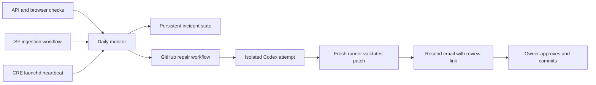

# Ingestion Monitor

A standalone Node service for SF Events and CRE Radar. Copy this directory into
its own repository; it has no imports, database connections, or dependencies on
either application's checkout. Node 22+ and Docker are supported.

It checks configured APIs, public pages, browser selectors, ingestion workflows,
and signed-in-by-token ingestion heartbeats once per 24 hours. A successful HTTP
200 alone does not prove an ingestion pipeline is healthy.



## Current readiness

The service and container have been tested locally. Both public sites have been
checked. Repair dispatch starts disabled; no monitor has been deployed, and no
agent or review email has been sent. The private source repository is
https://github.com/shane836/ingestion-monitor; publishing code does not activate
the service or its repair workflow.
CRE's heartbeat receiver is implemented, but its launchd wrapper is not yet wired
to it. The example configuration intentionally reports that missing heartbeat.

The activation checklist is [OPEN-ITEMS.md](OPEN-ITEMS.md).

## Run

```sh
npm ci
cp .env.example .env
# Populate the ignored .env locally; never paste credentials into chat.
npx playwright install chromium
npm test
npm run check       # one cycle; nonzero means an issue was found
npm start           # HTTP service; first cycle, then once every 24 hours
```

For an independent host:

```sh
docker compose up --build -d
docker compose logs -f monitor
```

The image runs as `pwuser`. The named volume preserves incident state. Compose
binds port 8080 to localhost. Put an HTTPS reverse proxy in front of it before
accepting heartbeats from other machines. Use one service replica: its JSON state
is atomic but is not a distributed database. Do not host the only monitor on the
same sleeping Mac whose launchd job it is meant to watch. A second project is
another `projects.json` entry, not another service or database.

The scheduler inspects its clock every minute, but contacts the applications only
once per 24 hours. Authenticated manual runs remain available for diagnosis.

## Configuration and endpoints

`projects.json` holds project IDs, repositories, branches, HTTP assertions,
browser selectors and freshness thresholds. Empty calendars can be legitimate:
set `minimumItems: 0` when empty results are valid. SF's broad upcoming-events
feed requires at least one event. CRE has a static page, so it needs a pipeline
heartbeat rather than an invented API endpoint.

| Endpoint | Purpose | Authorization |
|---|---|---|
| `GET /health` | Monitor process health | Public; returns only `ok` |
| `GET /status` | Last checks, incidents and dispatch failures | `MONITOR_API_TOKEN` |
| `POST /run` | Run one cycle; rejects overlapping cycles | `MONITOR_API_TOKEN` |
| `POST /heartbeats/cre-radar` | Store a completed/partial/failed pipeline result | `CRE_HEARTBEAT_TOKEN` |

Send tokens as `Authorization: Bearer …` headers. The admin token cannot submit
project heartbeats. Heartbeats are stamped by the receiver, not by a client clock.
Requests are bounded to 64 KiB. Example body, with no secret in it:

```json
{
  "status": "partial",
  "sources": [
    { "source": "example-calendar", "status": "completed" },
    { "source": "other-calendar", "status": "failed" }
  ]
}
```

A healthy source can return zero events. Report actual runner outcomes; never
translate "the process exited zero" into "every source succeeded" if the runner
can contain partial failures. Heartbeat freshness defaults to 36 hours, allowing
the daily scheduler some delay. A future CRE integration should post its existing
per-source outcomes after `cre-radar run`, preserve the pipeline exit code, and
surface transport failures in `cron.log`. It must not install a second scheduler
or run another ingestion against CRE's SQLite database. No changes to CRE are
needed for its public-site checks.

`/health` checks the service, not the monitored applications. Configure the
included daily GitHub watchdog with `MONITOR_HEALTH_URL` and enable GitHub failure
notifications to detect the monitor itself going offline. This is also where an
optional free Checkly uptime monitor could be used later.

## Enable repair and review emails

1. **Completed:** source is published in the private `shane836/ingestion-monitor`
   repository. No automatic commit is part of this service.
2. Add GitHub secrets `OPENAI_API_KEY`, `RESEND_API_KEY`, and, for private target
   repositories, `MONITOR_GITHUB_TOKEN`. Add repository variables
   `MONITOR_EMAIL_TO` and `MONITOR_EMAIL_FROM`. The latter must be a verified
   Resend sender. Keep this destination separate from all newsletter audiences.
3. Give the service's `GITHUB_TOKEN` **Actions write** on the monitor repository
   and **Actions read / Contents read** on the target repositories. It does not
   need Contents write. Give `MONITOR_GITHUB_TOKEN` only Contents read on private
   target repositories. The default workflow token can read public targets.
4. Set repository variable `MONITOR_REPAIR_ENABLED=true`, set
   `repair.repository` in `projects.json` to the real monitor repository, then
   set `repair.enabled=true`. Configure a dedicated OpenAI project spend limit
   appropriate to your budget before enabling it.
5. Dispatch a synthetic incident manually and review the resulting artifact and
   test email. Enable CRE heartbeats after its wrapper reports actual outcomes.

The service dispatches `repair-review.yml` with a configured project ID and
incident evidence. Workflow metadata resolves the repository's current branch to
an exact SHA. Each attempt has a 15-minute job limit. There is at most one repair
dispatch per project per UTC day; unchanged incident keys have a seven-day
cooldown. A healthy cycle rearms future incidents. Dispatch failures remain
visible and are retried next cycle. The dispatch receipt does not prove the agent
or email succeeded: review the linked GitHub run and its notifications.

The agent runs without production database, email, deployment or repository write
credentials. Its final structured output contains a diagnosis and unified diff.
A fresh runner enforces the allowed file paths, refuses stale bases and symlinks,
and independently applies and checks the patch. SF persistence tests get an empty
localhost PostgreSQL database. CRE's tests run in their own checkout with `uv`.
Workflows, credentials, dependencies and database migrations are outside automated
repair scope. An ambiguous merge or access block gets a diagnosis rather than an
automatic data change.

The owner email links to `diagnosis.txt`, `repair.patch` and validation logs in a
14-day artifact. Failed attempts also trigger an email. Empty patches mean
diagnosis only, even when the validator succeeds. Approval is manual: download
and review the patch, check that the base is still current, rerun relevant tests,
and explicitly commit it. Nothing auto-commits, pushes, merges or deploys.

## Cost and limitations

No Checkly subscription is required. Costs are the host you choose, GitHub runner
usage, agent API calls on incidents, and existing Resend usage. Two projects mean
roughly 62 browser checks a month at this initial cadence. Hosted scheduling is
daily, so an outage can remain undetected until the next cycle. This first version
groups incidents by failed check/job; it does not compare every individual event
or prove that all expected events were extracted. Heartbeats need honest
per-source reporting to detect silent ingestion failures.

Built with OpenAI Codex, directed and reviewed by the project owner.

References: [Codex GitHub Action](https://learn.chatgpt.com/docs/github-action),
[Checkly pricing](https://www.checklyhq.com/pricing/).
