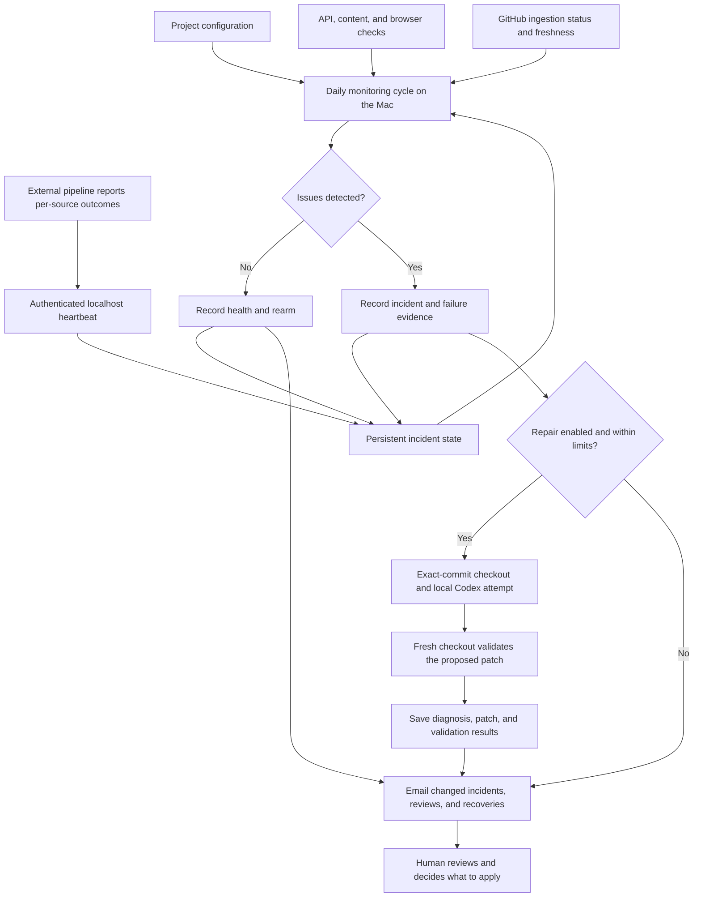

# Data Pipeline Monitor

A local monitoring and repair-review system for **data aggregation services**:
applications that collect outside data, process it on a schedule, and publish it
through an API or website.

A working page does not mean a working pipeline. A static site can keep serving
stale data, an API can return incomplete results, and a scheduled job can finish
with only some sources succeeding. This project combines checks of the published
application with evidence from the pipeline that feeds it.

When something fails, the monitor can ask Codex to investigate in a disposable
checkout, validate a proposed patch in a fresh checkout, and email the result for
human review. It never automatically commits, merges, or deploys a repair.

SF Events and CRE Radar are the case studies. This repository presents the
implementation and its tradeoffs as a portfolio project, rather than a packaged
monitoring product.

## Architecture



The Mac runs the scheduler, checks, repair orchestration, and email transport.
Codex uses OpenAI's hosted model through the existing CLI login. GitHub hosts the
code and supplies workflow evidence; no GitHub Actions runner or repository
secrets are required for this monitor.

## Two services, one monitoring model

| Case study | Published surface | Pipeline evidence | Failure the monitor can catch |
|---|---|---|---|
| SF Events | Events API and browser feed | GitHub Actions status, duration, and freshness | The site works while individual ingestion jobs fail |
| CRE Radar | Static site and browser page | Authenticated per-source heartbeat | Published content remains available after a pipeline or delivery failure |

The monitor imports neither application's code and opens no production database.
[projects.json](projects.json) defines each integration's checks, freshness
thresholds, repository, allowed repair paths, and validation commands. Other
scheduled feeds, directories, and research dashboards can use the same pattern
when they expose comparable health signals.

## Design decisions

- **Check behavior as well as uptime.** HTTP assertions inspect expected content
  and record fields. Playwright checks visible selectors and JavaScript errors.
  Workflow age and heartbeats provide execution evidence. Successful zero-record
  source results are valid; partial failures remain visible.
- **Remember incidents.** Failures are fingerprinted and persisted. The current
  configuration allows one repair attempt per project per UTC day and a seven-day
  cooldown for unchanged incidents. Recovery rearms future incidents. Attempt
  state is saved before Codex starts, preventing duplicate spending after restart.
- **Bring evidence into the sandbox.** The host retrieves GitHub failure logs and
  supplies bounded error excerpts. Lines containing obvious credentials or SQL
  are excluded, and URL query strings are stripped. Upstream text remains
  untrusted data. Retrieval errors are recorded.
- **Separate proposal from validation.** Codex works at an exact commit in a
  disposable checkout. Only its structured diagnosis and diff cross into a fresh
  checkout. The validator checks the declared base, permitted paths, and patch
  format before applying and testing it. An empty patch means diagnosis only.
- **Keep credentials local.** Ignored `.env` files hold monitor and email
  credentials. Repair children receive HOME, PATH, and TMPDIR rather than the
  monitor's tokens or production database variables. Codex uses its workspace-write
  sandbox. Dependency installation and validation run as the local user; these
  checkouts are not a machine isolation boundary.
- **Make review explicit.** Local artifacts retain successful, failed, and
  diagnosis-only attempts. Resend emails one private recipient when incident or
  review state changes, and after recovery. Repeated state is deduplicated. Email
  errors persist and can retry without another model attempt.

## What has been verified

The native macOS service is active, with automatic local repair enabled. Testing
on November 3, 2026 established:

- **16 passing regression tests** covering checks, heartbeat authentication,
  incident handling, patch restrictions, timeouts, evidence filtering, and email.
- **Live monitor-to-review execution** for both case studies. Both returned
  diagnosis-only results. SF Events' HTTP 405 failures and identity conflicts
  required human review; no application code repair was justified.
- **Controlled patch validation** in a fresh checkout, including disposable
  PostgreSQL startup and cleanup. The patch was a fixture, not a claimed model fix.
- **Restart persistence and repeat protection:** saved reviews survived restart;
  repeated incidents did not launch duplicate automatic attempts.
- **Heartbeat transport:** CRE Radar's existing sender received empty HTTP 204
  while reporting 20 recorded source outcomes as a partial run. This replay did
  not run ingestion or prove the next scheduled delivery.
- **Inbox delivery:** a uniquely identified Resend test message was found in the
  connected recipient Outlook mailbox. Repeated notification requests did not
  send duplicates.

## Explore the code

| File | Responsibility |
|---|---|
| [src/monitor.mjs](src/monitor.mjs) | Health checks, incident state, and repair limits |
| [src/service.mjs](src/service.mjs) | Local HTTP service, heartbeat receiver, and scheduler |
| [src/local-repair.mjs](src/local-repair.mjs) | Evidence collection, Codex execution, and fresh-checkout validation |
| [src/repair.mjs](src/repair.mjs) | Patch scope and base-SHA checks |
| [src/notify.mjs](src/notify.mjs) | Email change detection, transport, and receipts |
| [repair-prompt.md](repair-prompt.md) | Agent instructions and evidence-handling boundaries |
| [test/](test/) | Regression tests using controlled inputs |

With Node 22+:

```sh
npm ci
npm test
```

Tests do not contact the live applications or call a model. Live operations use
the configured case studies and can consume Codex account usage when repair is
enabled. [Maintainer notes](OPEN-ITEMS.md) cover local configuration, startup,
manual checks, endpoints, and remaining acceptance work.

## Tradeoffs and limits

Checks run once every 24 hours while the Mac is awake. Sleep or shutdown delays
them; an overdue cycle runs after resumption. Heartbeat freshness is 36 hours.
There is one service instance and no independent uptime watchdog. This setup
accepts gaps in exchange for avoiding a separate always-on host.

Assertions detect selected symptoms; they do not reconcile every record or prove
source coverage. Heartbeats depend on honest producer reporting. The next
scheduled CRE Radar heartbeat remains to be observed, and a seven-day cooldown
expiry has not been exercised in a live test.

Codex execution is limited to 15 minutes per attempt; installation and validation
also have time limits. Failed local attempts consume the same incident cooldown.
Manual repairs bypass scheduler limits. Artifacts and disposable checkouts remain
on disk until removed. Costs are local compute, existing Codex account usage, and
Resend usage. SF patch validation uses Docker for a disposable PostgreSQL database.

## How this was built

Built with OpenAI Codex, directed and reviewed by the project owner.
CLI integration follows [OpenAI's non-interactive Codex documentation](https://learn.chatgpt.com/docs/non-interactive-mode).
